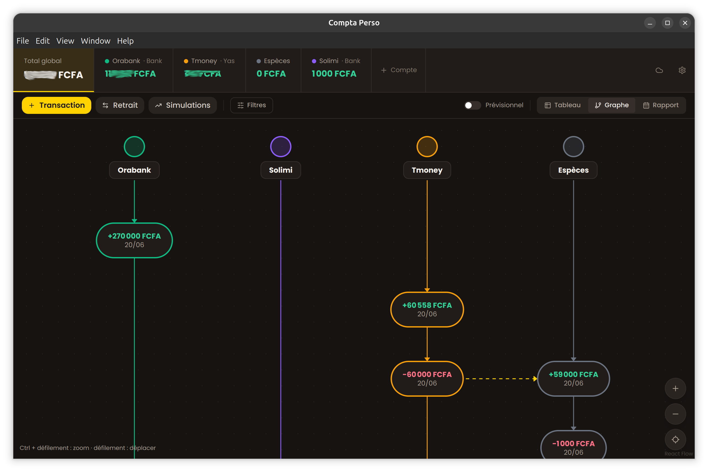

<div align="center">

# compta-perso-desktop

[](https://developer.mozilla.org/docs/Web/JavaScript)
[](https://github.com/goddivor/compta-perso-desktop/releases/latest)
[](./LICENSE)
[](https://github.com/goddivor/compta-perso-desktop/releases)

[](https://www.npmjs.com/package/electron)
[](https://www.npmjs.com/package/react)
[](https://www.npmjs.com/package/better-sqlite3)
[](https://www.npmjs.com/package/@xyflow/react)
[](https://www.npmjs.com/package/tailwindcss)
[](https://www.npmjs.com/package/electron-updater)

[](https://github.com/goddivor/compta-perso-desktop/stargazers)
[](https://github.com/goddivor/compta-perso-desktop/network/members)
[](https://github.com/goddivor/compta-perso-desktop/watchers)
[](https://github.com/goddivor/compta-perso-desktop/graphs/contributors)
[](https://github.com/goddivor/compta-perso-desktop/issues)

Track **personal accounts** on your own machine, without an account and without a
server. Balances, transactions, transfers between accounts, fees, forecasts and reports live in a
single **local SQLite** file.

The desktop half of Compta Perso: it shares its schema and its cloud sync with the
[mobile app](https://github.com/goddivor/compta-perso-mobile), through the
[sync API](https://github.com/goddivor/compta-perso-server).



</div>

## 🎖️ Features

- **Accounts side by side** — every account with its live balance in the top bar, reorderable by long press
- **Transactions table** — filter by account, type, category or period, edit and delete in place
- **Transfers between accounts** — one action writes both entries, keeps them paired, and splits the fees
- **Fee rules per account** — set a rate once, then apply it to any transaction with a single checkbox
- **Interactive graph** — one chronological column per account, transfers drawn across columns, pinch, scroll and zoom powered by React Flow
- **Daily report** — money in, money out and net balance for every day of the period
- **Forecast sessions** — simulate transactions, see the projected balance, validate to make them real
- **Cloud sync** — pull the configuration in one click, then push or pull a full snapshot
- **Automatic updates** — new releases are detected at launch, downloaded and installed from the app
- **Bilingual interface** — French and English, following the system language by default

## 📋 Requirements

- Linux x64 for the published builds (AppImage and `.deb`)
- Node.js >= 20 to build from source
- Nothing else: no account, no network, no external database

## 📦 Installation

Download the latest build from the [releases page](https://github.com/goddivor/compta-perso-desktop/releases/latest).

```bash
# AppImage: make it executable and run it
chmod +x "Compta-Perso-*.AppImage"
./Compta-Perso-*.AppImage

# Debian and Ubuntu
sudo dpkg -i compta-perso_*_amd64.deb
```

From a clone:

```bash
npm install
npm run dev
```

## ⚙️ Usage

```bash
# Development window with hot reload
npm run dev

# Compile main, preload and renderer
npm run build

# Build the AppImage and the .deb into dist/
npm run dist
```

### 📊 Graph controls

| Gesture | Action |
|---|---|
| Scroll | Move through the timeline |
| Ctrl + scroll, pinch | Zoom in and out |
| Drag, touch | Pan the canvas |
| Double click | Zoom to that point |
| Hover a node | Full details: label, amount, running balance |

### ☁️ Cloud sync

Sync is optional; the app is fully usable offline. Open the cloud icon in the top bar, press
**Fetch configuration** once, then use **Send to cloud** and **Fetch from cloud** to move a full
snapshot between machines. The API URL and token are never shown or typed by hand.

### 🗄️ Where the data lives

The database is a single SQLite file, kept out of the repository:

```bash
~/.config/compta-perso/data/compta.db
```

Copy that file to back it up, restore it, or move it to another machine.

## 🤝 Contributing

Contributions of all kinds are welcome: bug reports, feature ideas and pull requests. Open an
[issue](https://github.com/goddivor/compta-perso-desktop/issues) first for anything substantial,
and make sure `npm run build` passes before every commit.

## 📜 License

Licensed under MIT License and copyrights reserved.
